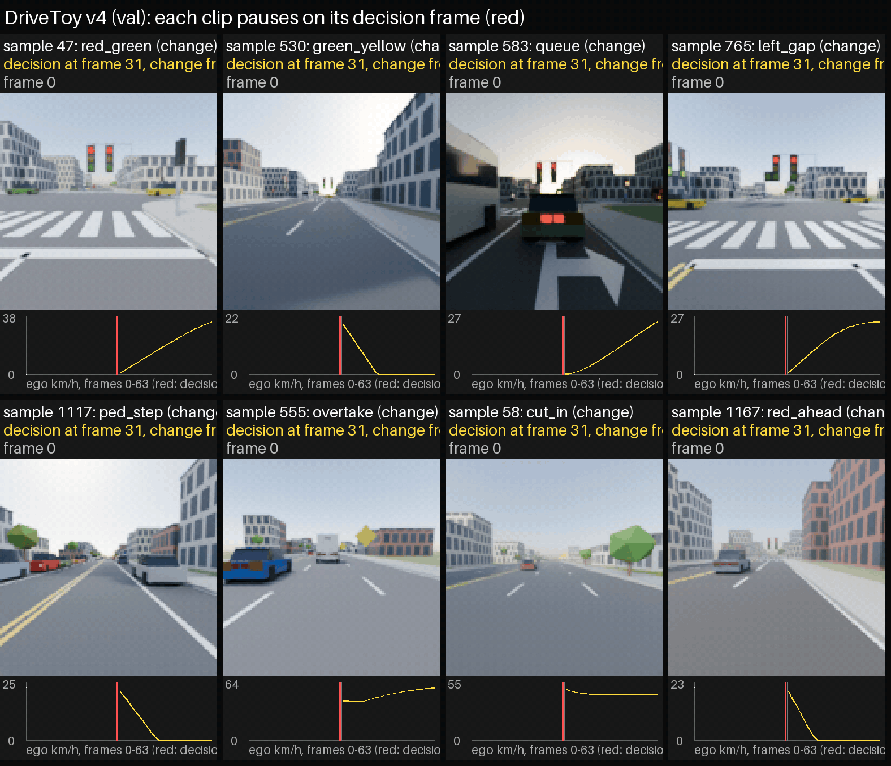
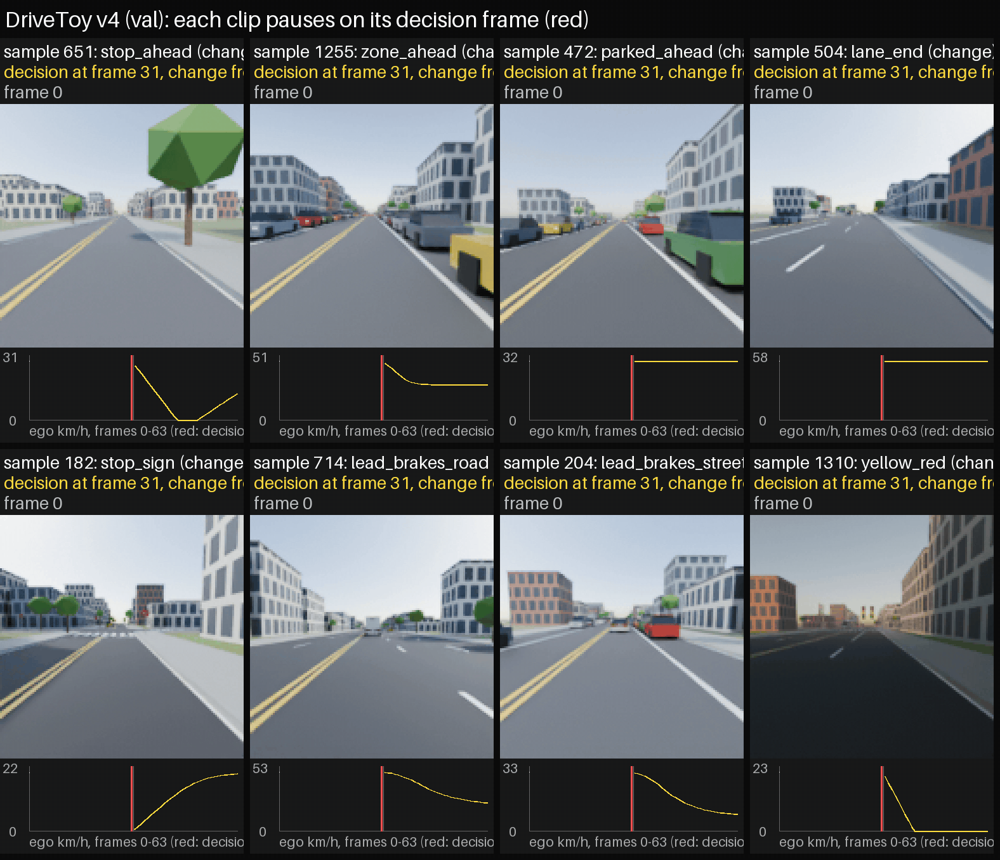
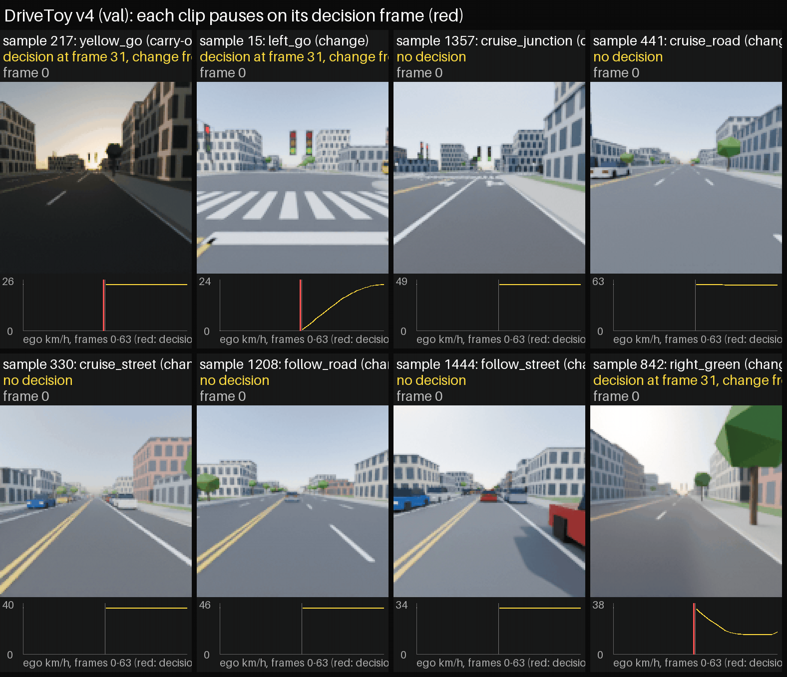
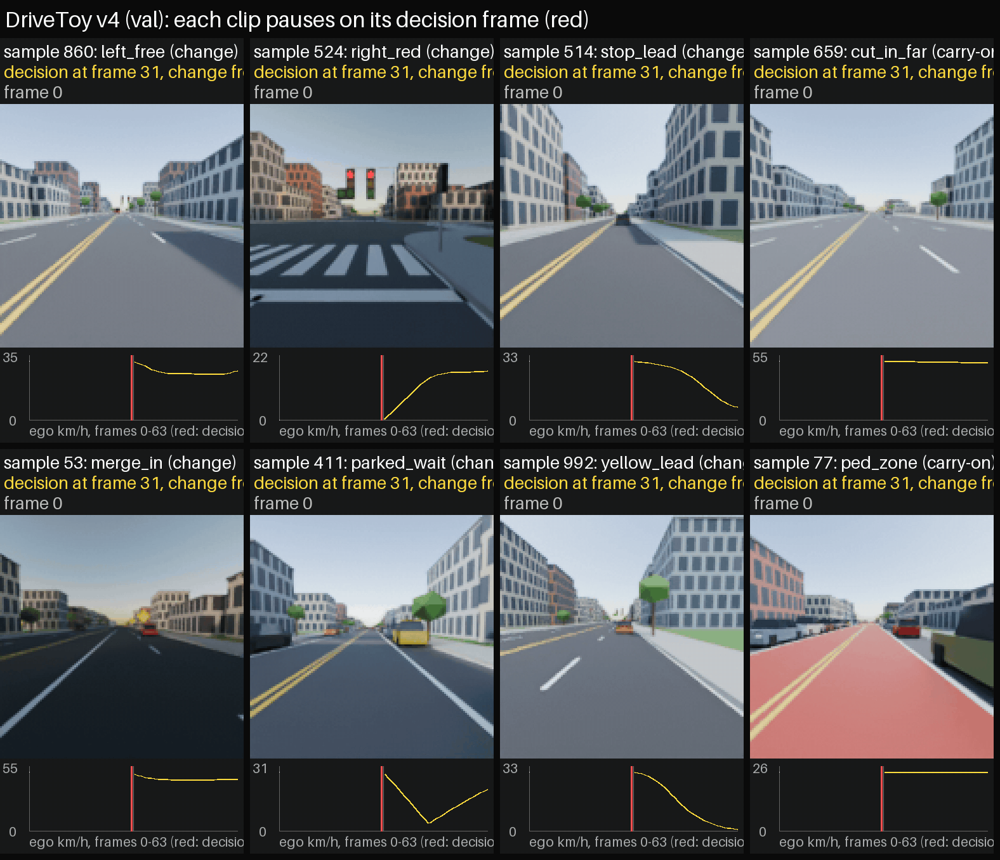
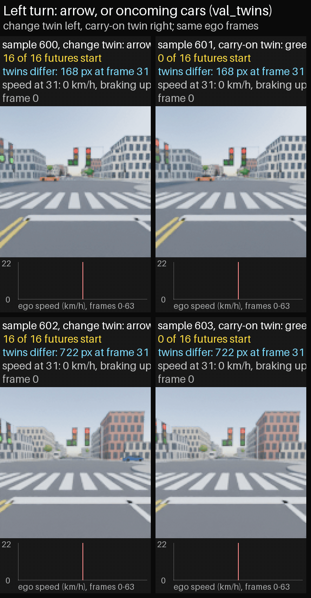
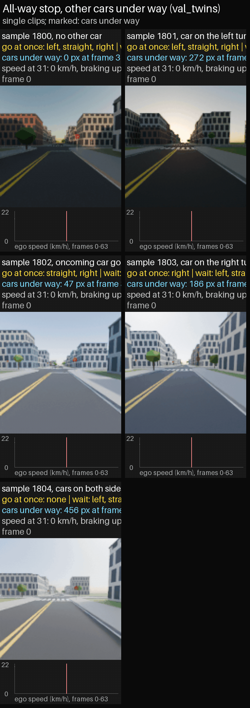

# DriveToy v4

DriveToy v4 is a procedural driving dataset built around decision points. In every clip with a decision, there is one frame $f_d$ at which the ego has to decide from what the camera shows: its own motion gives nothing away, and the cue is close enough to be clearly visible while a safe reaction is still possible. The scenes come from a lane-graph traffic simulator (IDM car following, MOBIL lane changes, signals, stop signs, pedestrians) and are rendered with Blender Cycles from the ego car's front camera. The code in this repository builds every split exactly, and [docs/drivetoy-v4-design.md](docs/drivetoy-v4-design.md) explains the design.

**Contents**

- [Data](#data)
- [Diversity](#diversity)
- [Situations](#situations)
- [Reproducing the data](#reproducing-the-data)
- [Code](#code)

## Data

The data is in `/root/projects/drive_v4` on the yt workspace (39 GB), and as `drive_v4_data.zip` (19.8 GB) on [Google Drive](https://drive.google.com/file/d/1zKSPDAxTllyIzxwloIY6Sae7ZRCJAWZi/view?usp=sharing).

| Split | Samples | Decision frame $f_d$ | Futures | Size |
|---|---:|---|---|---:|
| train | 10,000 | 7 (16%), 15 (17%), 23 (17%), 31 (23%), another frame from 1 to 30 (22%), none (5%) | one ground truth | 17 GB |
| val | 1,500 | 31 (95%), none (5%) | one ground truth, plus 16 futures | 5.1 GB |
| test | 1,500 | 31 (95%), none (5%) | one ground truth, plus 16 futures | 5.2 GB |
| val_twins | 1,900 | 31 | one ground truth, plus 16 futures | 6.2 GB |
| test_twins | 1,900 | 31 | one ground truth, plus 16 futures | 6.2 GB |

Each sample has 32 visible frames at $128 \times 128$ and 5 Hz (6.4 s), followed by 32 label-only frames; frames 32 to 63 are the ground truth. Because every decision in val and test falls on frame 31, an encoder that reads fewer frames uses the last $n$. The twin splits hold 100 counterfactual pairs for each of six twin situations (samples $2i$ and $2i+1$, change twin first, with identical ego motion over frames 0 to 31) and 100 single clips for each of seven single situations.

```
train/
├── labels/           one sample's labels per file, <n>.npz
├── maps/             one sample's map per file, <n>.json.gz
├── render/           one sample's frames and object-index pass per file, <n>.npz
├── scenes/           one sample's scene for Blender per file, <n>.json
├── logs/             the build's status lines and the plan it was built from
├── annotations.npz   the labels of all samples
├── future_set.npz    every sample's futures of frames 32 to 63 (one in train, 16 elsewhere)
└── meta.json         frame counts, label and situation names, and the build settings
```

The other splits have the same layout, plus `videos.npy` with all frames in one array of shape (N, 3, 32, 128, 128). `<n>` is the six-digit sample number. Besides the simulator's states (`ego`, `agents`, `lamps`, `signals` over all 64 frames) and the light, cause, response, path and choice labels A to E (`diversity`), each sample stores the following.

| Label | Shape | Meaning |
|---|---|---|
| `decision_frame` | () | $f_d$, or $-1$ without a decision; the twin splits leave it out, since it is always 31 there |
| `family` | () | the situation, an index into `meta["families"]` |
| `twin` | () | the member: 0 the change, 1 the carry-on, $-1$ for a single clip of a twin split |
| `pair` | () | the pair of a twin sample, $-1$ otherwise |
| `outcome` | per future | the ego's outcome over the 4 s after $f_d$: 0 stays, 1 starts, 2 stops, 3 keeps moving |
| `change` | per future | whether the future carries out the situation's change |
| `onset` | per future | the frame on which the ego's speed or heading starts to change, $-1$ if it holds |
| `variant`, `open_moves` | (), (3,) | at the all-way stop, the case (`meta["stop_cases"]`) and whether the left, straight and right moves are open |
| `ego_turn` | (), per future | the ego's move (`meta["ego_turns"]`): none, left, straight, right, or wait if it covers under 1 m from frame 31 to frame 63 |
| `may_go`, `may_go_reason` | (64,), (64,) | whether the ego may lawfully go at its stop line in each frame, and why not (`meta["may_go_reasons"]`) |
| `maps/<n>.json.gz` | one file per sample | the map, read with `drivetoy.map_io.load_map` |

## Diversity

Every sample has one label per aspect. Tables A to D give each label's share of the samples, computed from frames 0 to 31, so the shares of an aspect sum to 100%; Target is the mix the situation weights lean toward. A decision at frame 15 or later leaves its turn, lane change or stop to the frames after 31, and in val, test and the twin splits every decision falls on frame 31, so those splits show the approach to the decision rather than the manoeuvre: their paths are all straight in D. Over all 64 frames the paths in train are 66% straight, 13% left turns, 11% right turns, 6% lane changes or merges and 4% nudges. Table E gives the decision frames, which are hard quotas.

**A. Traffic light** (the light that governs the ego).

| Label | Description | Target | Train | Val | Test | val_twins | test_twins |
|---|---|---:|---:|---:|---:|---:|---:|
| no light | no traffic light governs the ego (stop-sign junctions and open road) | 50% | 50.7% | 50.8% | 51.0% | 52.6% | 52.6% |
| steady green | green throughout; the ego drives through or turns | 6% | 12.2% | 16.0% | 15.9% | 5.3% | 5.3% |
| steady red | red throughout; the ego stops at the line or waits there | 5% | 12.2% | 14.3% | 14.3% | 21.1% | 21.1% |
| red to green | the light turns green on screen and the ego pulls away | 10% | 6.7% | 8.5% | 8.5% | 15.8% | 15.8% |
| green to yellow | the light turns yellow on screen; the ego stops, or goes if it is too close to stop | 8% | 7.3% | 7.5% | 7.3% | 5.3% | 5.3% |
| yellow to red | the light turns red on screen; the ego stops, or clears the junction | 5% | 3.1% | 2.9% | 2.9% | 0.0% | 0.0% |
| arrow | a green left-turn arrow lets the ego turn left without yielding | 7% | 2.3% | 0.0% | 0.0% | 0.0% | 0.0% |
| permissive left | green ball while turning left; the ego waits for a gap in oncoming traffic | 9% | 5.6% | 0.0% | 0.0% | 0.0% | 0.0% |
| unlabelled | no label applies | | 0.1% | 0.0% | 0.0% | 0.0% | 0.0% |

**B. Cause** (what the ego reacts to in most of frames 5 to 31).

| Label | Description | Target | Train | Val | Test | val_twins | test_twins |
|---|---|---:|---:|---:|---:|---:|---:|
| none | nothing constrains the ego; free driving at the road's normal limit | 12% | 35.7% | 53.5% | 53.0% | 51.5% | 51.3% |
| lead vehicle | keeps its distance behind a slower car ahead | 10% | 16.2% | 16.0% | 15.8% | 21.1% | 21.1% |
| signal | stops for red or yellow and goes on green | 19% | 18.5% | 13.9% | 13.8% | 15.3% | 15.5% |
| stop sign | comes to a full stop at the line and waits its turn | 7% | 4.0% | 2.4% | 2.7% | 2.1% | 2.1% |
| oncoming traffic | waits for a gap in oncoming traffic before turning left | 9% | 5.6% | 6.7% | 6.7% | 5.3% | 5.3% |
| crossing traffic | at a stop sign, waits for a car on the cross street that has the right of way | 7% | 3.6% | 3.2% | 4.2% | 4.3% | 4.3% |
| pedestrian | yields to someone on or stepping onto the crosswalk | 12% | 4.1% | 0.5% | 0.2% | 0.5% | 0.4% |
| lane end | its lane ends (cones and a lane-ends sign), so it merges into the next lane | 8% | 1.5% | 0.1% | 0.0% | 0.0% | 0.0% |
| speed limit | slows down for the 30 km/h school zone | 6% | 4.9% | 3.7% | 3.7% | 0.0% | 0.0% |
| cut-in vehicle | a car from the next lane cuts in ahead of the ego | 7% | 4.0% | 0.1% | 0.0% | 0.0% | 0.1% |
| parked obstacle | a double-parked car blocks the lane; the ego waits behind it or steers around | 3% | 2.1% | 0.0% | 0.0% | 0.0% | 0.0% |

**C. Longitudinal profile** (what the ego's speed does).

| Label | Description | Target | Train | Val | Test | val_twins | test_twins |
|---|---|---:|---:|---:|---:|---:|---:|
| cruise | steady speed, no stop | 18% | 34.7% | 57.8% | 58.3% | 52.6% | 52.6% |
| follow | speed set by the car ahead for at least half the clip | 12% | 11.8% | 13.0% | 12.7% | 10.5% | 10.6% |
| slow down | speed drops by more than 3 m/s without stopping | 14% | 14.6% | 0.0% | 0.0% | 0.0% | 0.0% |
| stop | moving, then comes to a stop | 16% | 12.8% | 8.4% | 7.9% | 9.6% | 9.9% |
| wait | stands still for most of the clip | 6% | 14.4% | 20.8% | 21.1% | 27.3% | 26.9% |
| pull away | starts stopped, then drives off | 16% | 10.8% | 0.0% | 0.0% | 0.0% | 0.0% |
| stop and go | stops and drives off again within the clip | 18% | 0.8% | 0.0% | 0.0% | 0.0% | 0.0% |

**D. Lateral manoeuvre** (what the ego's path does).

| Label | Description | Target | Train | Val | Test | val_twins | test_twins |
|---|---|---:|---:|---:|---:|---:|---:|
| straight | heading changes by less than $15^\circ$ | 40% | 89.0% | 100.0% | 100.0% | 100.0% | 100.0% |
| left turn | turns left by more than $45^\circ$ | 18% | 1.4% | 0.0% | 0.0% | 0.0% | 0.0% |
| right turn | turns right by more than $45^\circ$ | 16% | 1.9% | 0.0% | 0.0% | 0.0% | 0.0% |
| lane change | moves into the next lane, indicator on first | 10% | 1.2% | 0.0% | 0.0% | 0.0% | 0.0% |
| merge | lane change out of a lane that ends | 8% | 1.5% | 0.0% | 0.0% | 0.0% | 0.0% |
| nudge around | steers briefly sideways around an obstacle and back into its lane | 8% | 0.6% | 0.0% | 0.0% | 0.0% | 0.0% |
| unlabelled | a turn still under way at frame 31 | | 4.5% | 0.0% | 0.0% | 0.0% | 0.0% |

**E. Decision frame** (the frame $f_d$ on which the ego must decide from what it sees).

| Decision frame | Train | Val | Test | val_twins | test_twins |
|---|---:|---:|---:|---:|---:|
| 7 | 1,600 (16.0%) |  |  |  |  |
| 15 | 1,700 (17.0%) |  |  |  |  |
| 23 | 1,700 (17.0%) |  |  |  |  |
| 31 | 2,300 (23.0%) | 1,425 (95.0%) | 1,425 (95.0%) | 1,900 (100.0%) | 1,900 (100.0%) |
| another frame from 1 to 30 | 2,200 (22.0%) |  |  |  |  |
| no decision | 500 (5.0%) | 75 (5.0%) | 75 (5.0%) |  |  |

The fifth entry of `diversity` keeps the simulator's own choice label (`meta["diversity"]["E"]`), which the decision frame replaces as the aspect to balance.

## Situations

The 32 situations cover signals, stop signs, pedestrians, other vehicles and road signs, plus five without a decision; the design doc lists them with their change and carry-on members. Whatever happens in frames 32 to 63 follows from frames 0 to 31: the ego starts again late only when the cause already shows by frame 31, and it turns left across traffic only with the gap clear at the decision. Each GIF below shows one val clip per situation, eight at a time: the camera view of frames 0 to 31 pauses on the decision frame, and the plot under it shows the ego's speed over frames 0 to 63 with the decision marked in red.






In the twin splits, the two members of a pair share everything up to the cue. The GIFs show pairs side by side (change twin left, carry-on twin right), then hold frame 31 with the cue, or the pixels where the twins differ, marked in magenta; the plot shows all 16 futures.




## Reproducing the data

Each split is built from its plan, `plans/<split>.json`. In train, val and test an entry is one clip: its situation, member, decision frame, variant and stage. In the twin splits an entry is a pair or a single clip. Every random draw follows from the split's base seed and the entry's index, so the plan fixes the data.

The stage records which state of the code built the entry, and `drivetoy/decision.py` keeps the few places where those states differ behind `set_stage`.

| Stage | Train | Val | Test | val_twins | test_twins |
|---|---:|---:|---:|---:|---:|
| `train1` | 6,792 | | | | |
| `twins` | | | | 1,086 | 1,086 |
| `final` | 2,680 | 1,400 | 1,404 | 8 | 9 |
| `clean` | 528 | 100 | 96 | 206 | 205 |

The table counts plan entries, so a twin pair counts once. New clips use `clean`, the only stage that enforces every rule of the design doc; the audit of the stored data found no clip of the earlier stages that breaks those rules.

```
bash scripts/build_all.sh /root/projects/drive_v4                  # all five splits, then report.md
python scripts/build.py --split val --out /root/projects/drive_v4    # one split; resumes where it stopped
python scripts/check_reproduce.py --split val --render 6             # rebuild and compare with the stored data
```

`build_all.sh` simulates each split while the previous one renders, and renders one split at a time, since each Blender process takes about 1.8 GB of a 24 GB GPU. `check_reproduce.py` re-simulates every sample into a scratch folder and compares its labels, scene, map and futures with the stored files, along with `meta.json`; with `--render k` it also re-renders $k$ samples. In the last check, every `clean` entry and 200 others per split matched exactly, 2,698 samples in all. Before the `clean` stage was added, all 16,800 samples matched. Re-rendered frames differ from the stored ones by at most 1 of 255, since Cycles on the GPU is not bit-exact, and the object-index passes are identical.

## Code

- `drivetoy/sim.py` is the traffic simulator, `rules.py` its rule checker and `roads.py` the four road templates.
- `drivetoy/decision.py` holds the decision scenes, and `scenarios.py` the helpers that place the ego and other cars in them.
- `drivetoy/diversity.py` computes the labels A to E, and `builder.py` renders a split with `blender/render_clip.py` and stacks its files.
- `scripts/build.py` builds one split, and `scripts/build_all.sh` builds them all.
- `scripts/check_reproduce.py` checks that the code rebuilds the stored data.
- `scripts/report.py` writes the per-split summary (`report.md` in the data folder).
- `scripts/clip_gifs.py` and `scripts/twin_gifs.py` make the GIFs above, and `scripts/zip_folder.py` zips a folder for upload.
