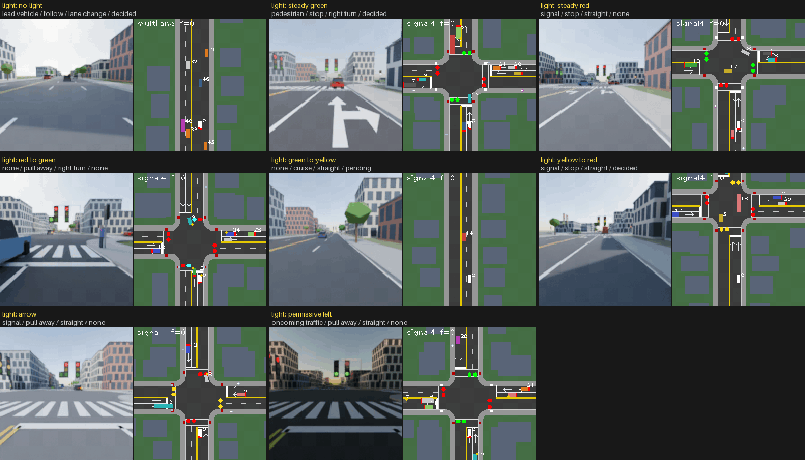
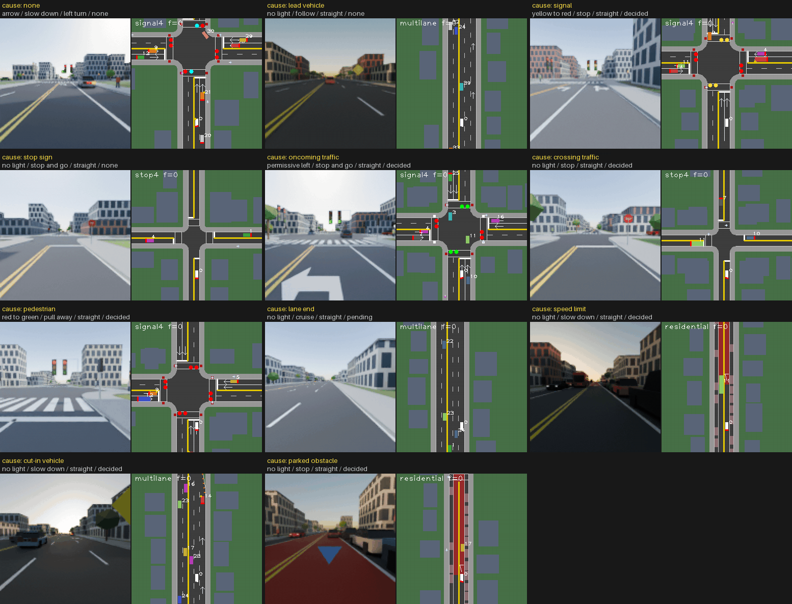
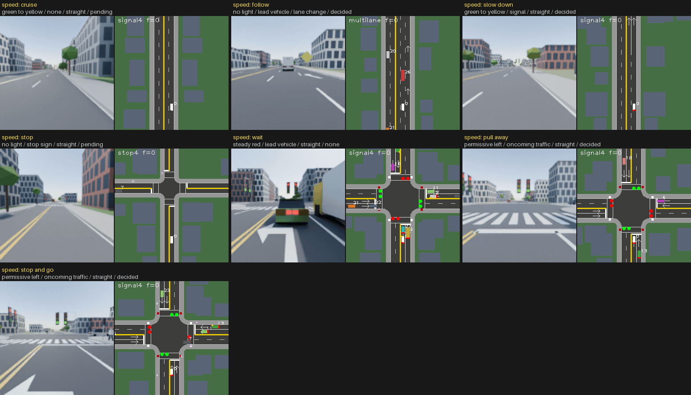
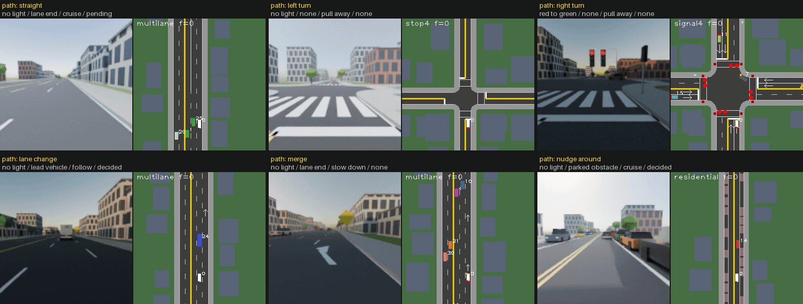
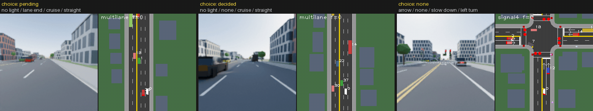
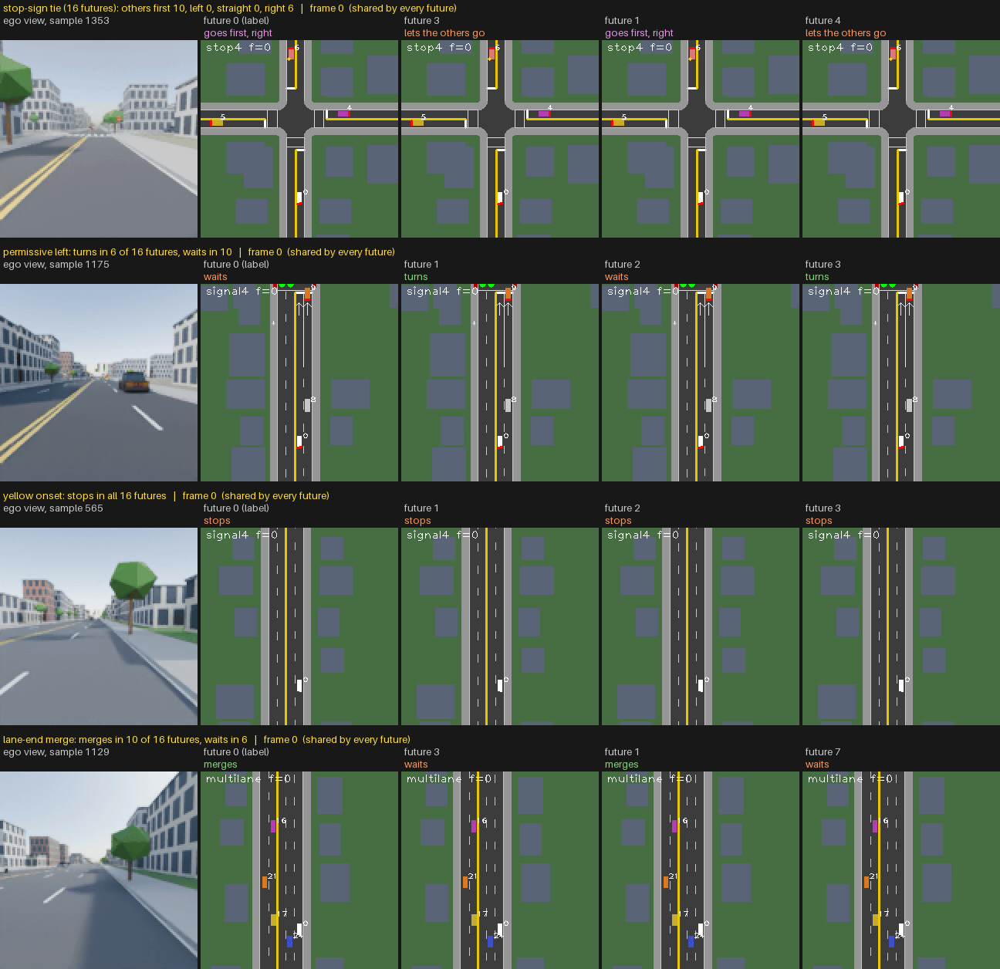

# DriveToy v3

DriveToy v3 is a procedural driving dataset: a lane-graph traffic simulator (IDM car following, MOBIL lane changes, signals, stop signs, pedestrians) rendered with Blender Cycles from the ego car's front camera. It is built by the code in this repository. [revision-history.md](docs/revision-history.md) lists the issues versions 2 and 3 address, and [task_encoder_eval.md](docs/task_encoder_eval.md) describes the evaluation its labels serve.

**Contents**

- [Data](#data)
- [Diversity](#diversity)
- [Stochasticity](#stochasticity)
  - [Future sets](#future-sets)
- [Scripts and tests](#scripts-and-tests)

## Data

Download Link: https://drive.google.com/file/d/14tdae9gY0qZotpeHoUoW4sdveZDlyd71/view?usp=sharing

From terminal,
```
pip install gdown
gdown 1lR_zs8O2vDCyMIBwjvDXKmraVL8CueoQ
```

| Split | Clips | Samples | `signal4` | `stop4` | `multilane` | `residential` |
|---|---:|---:|---:|---:|---:|---:|
| train | 10,000 | 10,000 | 5,000 | 1,350 | 1,953 | 1,697 |
| val | 1,500 | 1,500 | 750 | 193 | 296 | 261 |
| test | 1,500 | 3,000 | 1,500 | 416 | 606 | 478 |

Each sample has 32 visible frames at $128 \times 128$ and 5 Hz (6.4 s), followed by 32 label-only frames. A test clip has two futures that share frames 0 to 4, so it gives two samples. 

```
train/
├── labels/           one sample's labels per file, <n>.npz
├── maps/             one sample's map per file, <n>.json.gz
├── render/           one sample's frames per file, <n>.npz
├── scenes/           one sample's scene for Blender per file, <n>.json
├── annotations.npz   labels of all samples, including the scoring labels below
├── checks.json       the split's checks
├── future_set.npz    16 futures per sample from frame 31, with their scoring labels
└── meta.json         frame counts, label names and build settings
```

Val and test have the same layout, plus `videos.npy` with all frames in one array. `<n>` is the six-digit sample number.

| Label | Shape | Meaning |
|---|---|---|
| `maps/<n>.json.gz` | one file per sample | the map (lane graph, signals, signs, crosswalks, school zone), read with `map_io.load_map`; parked cars standing in a lane are vehicles in `agents`, not part of the map |
| `may_go` | (64,), futures (16, 32) | 1 if the ego may lawfully go at the stop line of its route in that frame, 0 if not, $-1$ without a junction ahead |
| `may_go_reason` | (64,), futures (16, 32) | why it may not go, as an index into `meta["may_go_reasons"]`: none, light, oncoming, pedestrian, conflict, stop order |
| `ego_turn` | (), futures (16,) | the ego's move at the junction: 0 none, 1 left, 2 straight, 3 right |
| `route_drawn` | () | whether the 16 futures drew the ego's route (see [Future sets](#future-sets)) |

## Diversity

Every sample has one label per aspect, computed from frames 0 to 31 (cause from frames 5 to 31; E from the choices in frames 0 to 40), so the shares of an aspect sum to 100%. The tables give the sampler's target share and the share actually built in each split; the test shares count both futures of a clip. Under each table, a GIF shows one val clip per label, the ego view beside the top-down map, with the clip's labels above it.

**A. Traffic light** (the light that governs the ego).

| Label | Description | Target | Train | Val | Test |
|---|---|---:|---:|---:|---:|
| no light | no traffic light governs the ego (stop-sign junctions and open road) | 50% | 50.0% | 50.0% | 50.0% |
| steady green | green throughout; the ego drives through or turns | 6% | 6.0% | 6.0% | 6.0% |
| steady red | red throughout; the ego stops at the line or waits there | 5% | 5.0% | 5.0% | 5.0% |
| red to green | the light turns green on screen and the ego pulls away | 10% | 10.0% | 10.0% | 10.0% |
| green to yellow | the light turns yellow on screen; the ego stops, or goes if it is too close to stop | 8% | 8.0% | 8.0% | 8.0% |
| yellow to red | the light turns red on screen; the ego stops, or clears the junction | 5% | 5.0% | 5.0% | 5.0% |
| arrow | a green left-turn arrow lets the ego turn left without yielding | 7% | 7.0% | 7.0% | 7.0% |
| permissive left | green ball while turning left; the ego waits for a gap in oncoming traffic | 9% | 9.0% | 9.0% | 9.0% |



**B. Cause** (what the ego reacts to in most of frames 5 to 31).

| Label | Description | Target | Train | Val | Test |
|---|---|---:|---:|---:|---:|
| none | nothing constrains the ego; free driving at the road's normal limit | 12% | 21.3% | 21.2% | 21.7% |
| lead vehicle | keeps its distance behind a slower car ahead | 10% | 10.4% | 10.1% | 10.7% |
| signal | stops for red or yellow and goes on green | 19% | 16.5% | 16.3% | 16.2% |
| stop sign | comes to a full stop at the line and waits its turn | 7% | 6.1% | 6.1% | 6.6% |
| oncoming traffic | waits for a gap in oncoming traffic before turning left | 9% | 9.5% | 9.5% | 10.1% |
| crossing traffic | at a stop sign, waits for a car on the cross street that has the right of way | 7% | 5.3% | 5.1% | 5.0% |
| pedestrian | yields to someone on or stepping onto the crosswalk | 12% | 8.1% | 7.8% | 7.5% |
| lane end | its lane ends (cones and a lane-ends sign), so it merges into the next lane | 8% | 8.6% | 9.2% | 9.4% |
| speed limit | slows down for the 30 km/h school zone | 6% | 3.9% | 4.1% | 4.3% |
| cut-in vehicle | a car from the next lane cuts in ahead of the ego | 7% | 4.0% | 4.1% | 3.2% |
| parked obstacle | a double-parked car with hazard lamps blocks the lane; the ego waits behind it or steers around | 3% | 6.4% | 6.5% | 5.4% |



**C. Longitudinal profile** (what the ego's speed does).

| Label | Description | Target | Train | Val | Test |
|---|---|---:|---:|---:|---:|
| cruise | steady speed, no stop | 18% | 17.1% | 18.2% | 18.0% |
| follow | speed set by the car ahead for at least half the clip | 12% | 7.2% | 6.9% | 7.4% |
| slow down | speed drops by more than 3 m/s without stopping | 14% | 34.5% | 33.7% | 33.5% |
| stop | moving, then comes to a stop | 16% | 15.7% | 16.0% | 15.3% |
| wait | stands still for most of the clip | 6% | 4.0% | 3.6% | 4.4% |
| pull away | starts stopped, then drives off | 16% | 15.2% | 15.7% | 15.7% |
| stop and go | stops and drives off again within the clip | 18% | 6.3% | 5.9% | 5.8% |



**D. Lateral manoeuvre** (what the ego's path does).

| Label | Description | Target | Train | Val | Test |
|---|---|---:|---:|---:|---:|
| straight | heading changes by less than $15^\circ$ | 40% | 76.7% | 78.0% | 78.1% |
| left turn | turns left by more than $45^\circ$ | 18% | 8.2% | 7.5% | 7.9% |
| right turn | turns right by more than $45^\circ$ | 16% | 5.7% | 5.7% | 4.9% |
| lane change | moves into the next lane, indicator on first | 10% | 3.4% | 2.6% | 3.3% |
| merge | lane change out of a lane that ends | 8% | 2.5% | 2.9% | 2.4% |
| nudge around | steers briefly sideways around an obstacle and back into its lane | 8% | 3.5% | 3.3% | 3.4% |



**E. Choice at frame 31** (the state of the ego's major choices, see [Stochasticity](#stochasticity)).

| Label | Description | Target | Train | Val | Test |
|---|---|---:|---:|---:|---:|
| pending | a major choice is cued on screen by frame 31 and falls in frames 32 to 40 | 40% | 21.1% | 23.6% | 23.3% |
| decided | the major choice is made on screen, and only minor variation is left | 45% | 41.9% | 39.4% | 39.5% |
| none | the clip has no major choice | 15% | 37.0% | 37.0% | 37.3% |



The sampler meets A first and treats B, C and D as targets, so the later aspects drift where a combination is hard to build. A turn from a standstill rarely passes $45^\circ$ within 6.4 s, so "straight" is over its share and both turns are under. "Speed limit" comes only from the 30 km/h school zone of the `residential` template, which keeps it under its share.

# Stochasticity

The ego and the road users around it behave stochastically where real drivers differ. Major choices have a few distinct outcomes whose odds follow a cue the video shows, and minor variation comes from per-driver and per-event draws. The task encoder learns from frames 32 to 63, either forecasting them from frames 0 to 31 or forecasting each 8-frame window from the frames before it, so these futures vary where real driving varies and stay predictable where it does not.


## Future sets

Each sample gets 16 futures of frames 32 to 63, forked at frame 31 and stored as states in `future_set.npz`, with future 0 as its own label. When the ego has not signalled by frame 31 and its lane allows several moves, each future also draws the ego's move with equal odds.



See more samples of future alternatives in [forked-futures.md](docs/forked-futures.md).

# Other Documents
- See more how 16 future alternatives differ across scenes in -> [forked-futures.md](docs/forked-futures.md)
- See how each version of drive_toy differ in -> [revision-history.md](docs/revision-history.md)

## Scripts and tests

- `scripts/run_all.sh [out_dir]`: the full build into `out_dir` (default `/root/projects/drive_v3`), with status lines in `<out_dir>/logs/status.log`.
- `scripts/build_drivetoy_v3.py --split <train|val|test> --gpus 0,1,2,3`: builds a split into `/root/projects/drive_v3/<split>` (simulation, then rendering) and resumes where it stopped.
- `scripts/v3_checks.py <split> [--resim]`: the checks above (with `scripts/base_checks.py`), written to `<split>/checks.json`.
- `scripts/make_gifs.py <split> --out <dir>`: `diversity_<aspect>_v3.gif` (A to E, one clip per label), `pending_v3.gif` (one pending clip per kind of choice) and `forks_v3.gif` (four futures of a pending clip, forked at frame 31). With `--showcase`, it writes instead the six `forks_<category>_v3.gif` of [forked-futures.md](docs/forked-futures.md), four val samples each.
- `scripts/zip_folder.py <folder> <zip>`: the data and code archives.
- The tests run as plain scripts (`python3 tests/test_v3_leads.py`).
