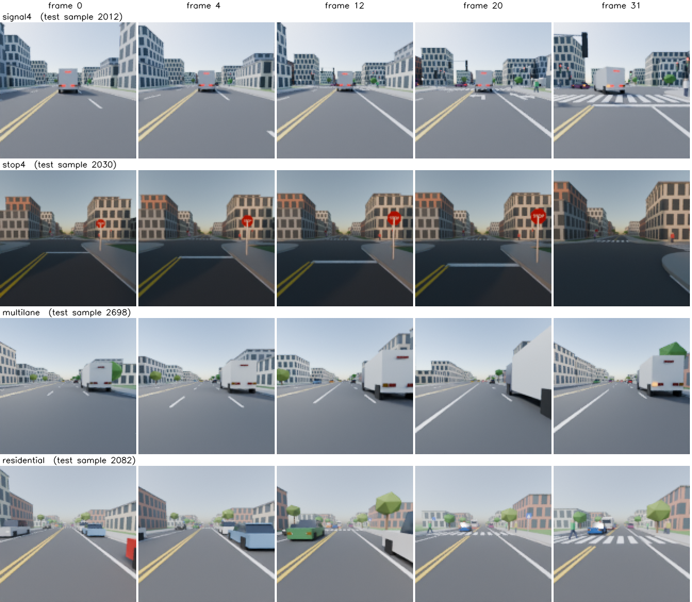
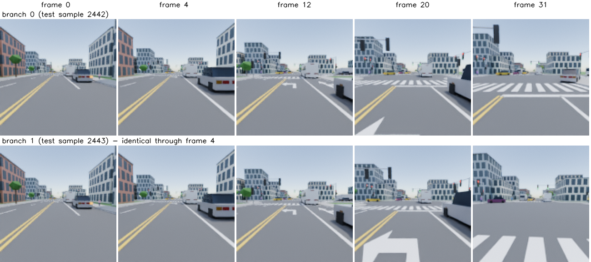

# DriveToy

**An ego-view driving toy whose future is decided by traffic rules, and whose rules show only as
visual cues in the video.** Every clip is a 6.4 s dashcam view of a small traffic scene
(signalised and stop-sign junctions, a merging multi-lane road, a residential street). Every
agent in it follows a fixed, simplified rulebook, so any future a model draws can be checked
against the same rules. The observed frames do not decide the future: a turn, a pedestrian's
intent or a signal's remaining time is drawn only after frame 4, and the test set holds two
such futures per context.

It plays the role CubeToy plays for physics: the context does not determine the future, so a
generated clip is judged by whether it breaks a rule (`rules.py`), not by how close it is to
the one recorded future. Code: `f_toy/datasets/drivetoy/`.



---

## 1. At a glance

| | |
|---|---|
| view | the ego car's dashcam: 1.3–1.5 m high, pitch −6° to −2°, 70° horizontal FOV |
| clip | 32 frames at 5 Hz (6.4 s), 128×128 RGB, rendered with Blender Cycles |
| label-only future | 32 more simulated frames after the clip (states only, no video) |
| branch frame | frame 4: every future of a context is identical through raw frames 0–4 (the ctx2 observation) |
| train | 10,000 clips, one future each (simulator seed `0 + clip_id`) |
| test | 2,000 contexts × 2 futures = 4,000 samples (seed `10,000,000 + clip_id`); sample `n = 2·context + branch` |
| template mix | `signal4` 35%, `stop4` 20%, `multilane` 25%, `residential` 20% (sampling weights) |
| size | ~26 GB unpacked (videos 21 GB) |

By convention test contexts **0–999 are for scoring models and 1000–1999 for calibrating
evaluation thresholds**, so a threshold is never fixed on the clips it scores.

---

## 2. Rulebook

Right-hand traffic, no right turn on red. Every rule is defined on simulator state alone. The
**policy** is what agents do; the **check** is what `rules.py` counts as a violation. Checks are
looser than policies so lawful driving never sits on the boundary.

| | Rule | Policy (agents) | Check (violation) |
|---|---|---|---|
| R0 | speed limit | desired speed 85–97% of the limit | v > limit + 0.5 m/s |
| R1 | red / yellow | red: stop before the line. At yellow onset: stop if the needed deceleration v²/2d ≤ 3 m/s², otherwise go | crosses the line on red / goes on yellow although it could have stopped at ≤ 2 m/s² |
| R2 | green | go when the path is clear | (no check) |
| R3 | permissive left turn | approach so as to reach the line at ≤ 4 m/s; without an arrow, enter only if oncoming traffic is ≥ 4 s from the conflict point and none is inside the junction | oncoming time-to-arrival < 2.5 s in either frame around the line crossing |
| R4 | stop sign | full stop (v < 0.3 m/s) for ≥ 1 s within 5 m of the line; first to stop goes first, ties within 0.4 s go to the right, a four-way tie in fixed order | fewer than 4 consecutive stopped frames (0.6 s) in the 6 m zone / enters while a vehicle from another approach that stopped first is still waiting |
| R5 | crosswalk | stop for a pedestrian who is crossing or stepping off the curb | enters the crosswalk while a pedestrian is crossing within ±3 m of its path |
| R6 | following distance | IDM time headway 1.2–1.8 s | gap < max(1 m, 0.5 s·v) / boxes overlap (collision) |
| R7 | lane change | only across a dashed line, indicator ≥ 1.6 s first, new follower brakes ≤ 2 m/s² (MOBIL), no new change within 2 s | body centre crosses a solid line / indicator on < 1.0 s before |
| R8 | lane drop | zipper merge in order of arrival | via R6 only |
| P1 | pedestrian signal | start crossing only on WALK | starts on DON'T WALK |
| P2 | unsignalised crosswalk | do not step out if a vehicle could not stop at ≤ 3 m/s², or one is on the crosswalk | a vehicle would need > 4 m/s² to stop, or one moves > 1 m/s on the crosswalk |

Lamps have fixed meanings, so lamp cues never contradict motion:

| Lamp | On when |
|---|---|
| brake | deceleration > 0.6 m/s², or stopped (v < 0.3 m/s) |
| indicator | from 30 m before the stop line ahead of a turn, and from 1.6 s before a lane change until it ends; blinks 2 frames on / 2 off (0.8 s, no aliasing at 5 Hz), random phase per vehicle |
| hazard | reserved for stopped / double-parked vehicles; never lit in this release |

---

## 3. Visual cues

The same rule state is visible through several layers, and each clip records which cues were
actually visible, per frame (`cue_visibility`, pixel counts from the renderer's object-index pass).

| Layer | Content |
|---|---|
| 1 static infrastructure | signs (stop, speed limit, lane ends, school zone); stop lines, crosswalks, lane arrows, solid / dashed / double-yellow lines, school-zone red pavement |
| 2 dynamic infrastructure | vehicle signals (red / yellow / green, protected-left arrow), pedestrian signals, countdown |
| 3 lamps | brake lights, indicators, hazards |
| 4 implied behaviour | slowing, drifting toward a lane, creeping into a junction, a pedestrian waiting at or facing the curb (from the dynamics) |
| 5 indirect / occluded | a queue ahead hiding the signal, cross traffic, a sudden stop in the next lane |

The 9 recorded cues: `veh_signal`, `ped_signal`, `stop_sign`, `other_sign`, `crosswalk`,
`brake_lit`, `indicator_lit`, `vehicle`, `pedestrian`. Vehicle lamps and signal heads are drawn
1.5× real size (`DT_CUE_SCALE`); at 128 px a lit indicator is still only ~7 px (median, when visible).

---

## 4. Scene templates

| Template | Road | Rules mostly exercised | Limit |
|---|---|---|---|
| `signal4` | 4-way signalised junction; per approach a left-turn lane and a straight/right lane; crosswalks and pedestrian signals on all four legs; protected-left arrow in half the maps, pedestrian countdown in 60% | R1–R3, R5, P1 | 50 km/h |
| `stop4` | 4-way stop, one lane per approach, a crosswalk on each leg with probability 0.6 | R4, R5 | 40 km/h |
| `multilane` | 3 lanes northbound + 2 southbound; the outer lane closes behind a cone taper; solid-line section | R6–R8, R0 | 70 km/h |
| `residential` | two-lane street with parking lanes on both sides, an unsignalised crosswalk in a school zone | R5, P2, R0, occlusion | 50 / 30 km/h |

Appearance varies per clip: vehicle type (car 55%, SUV 25%, truck 12%, bus 8%) and colour,
pedestrians (adult 80%, child 20%), time of day (day 75%, dusk 25%), fog in 30% of clips,
camera height and pitch. All assets are procedural low-poly geometry built in code; there are
no external asset files.

---

## 5. Branching futures

The rules are deterministic, so a future can only branch on freedoms outside them. Every hidden
variable gets its value **the first time it is used**: before the branch frame from the scene's
RNG, after it from a per-branch RNG. The builder simulates once up to frame 4, copies the
simulator state and continues it K times, so the K futures are byte-identical through frame 4
and differ only afterwards.

| Hidden variable | First used | Cue that reveals it |
|---|---|---|
| turn choice | 30 m before the stop line | indicator |
| pedestrian's intent and start delay | reaching the curb | body direction, stepping off |
| remaining signal time | countdown start or phase end | countdown, yellow |
| lane-change intent (MOBIL politeness) | first lane-change evaluation | indicator |

The ego is placed so that its own trajectory does something inside the clip: 38–52 m before a
signal's stop line (the turn decision falls after frame 4), 6–22 m before a stop sign, in the
closing lane 40% of the time on `multilane`, and a pedestrian reaches the curb ahead of it in
70% of `residential` clips. A scene is redrawn if no decision event (signal change, indicator,
lane change, stop / go, yield, pedestrian decision) happens in the ego's view after frame 4.



On test, 29% of branch pairs differ visibly by frame 31 (mean |pixel difference| > 1/255);
many simulated divergences happen outside the view or stay small.

---

## 6. How it is built

```
simulate (CPU)  ->  scenes/<n>.json, labels/<n>.npz
render (Blender Cycles, GPU)  ->  render/<n>.npz (RGB + object index)
assemble  ->  videos.npy, annotations.npz, meta.json
```

1. **Simulate** (`scenarios.py`, `sim.py`, `roads.py`). A template is drawn and its map built.
   Vehicles follow IDM along a route of lanes; every rule is an extra IDM obstacle (a virtual
   stopped car at the stop line, at the crosswalk, ...), and the obstacle that binds becomes the
   vehicle's `rule_state`. Lane changes use MOBIL; pedestrians walk polylines and decide at the
   curb. 25 warm-up frames (5 s) run before frame 0 so queues and signal phases settle; the ego
   is inserted at the end of the warm-up. Each frame is integrated in 4 substeps.
2. **Render** (`export.py`, `blender/render_clip.py`). The simulator writes one JSON per sample
   (static map, look, camera, per-frame states). Blender rebuilds the scene procedurally and
   renders RGB plus an object-index pass with Cycles (16 spp, OIDN denoising on the GPU, AgX view
   transform). Several Blender processes run per GPU.
3. **Assemble** (`builder.py`). Labels are stacked into `annotations.npz`, `cue_visibility` is
   counted from the index pass, and videos go to a `uint8` memmap. The futures of one test context
   get branch 0's rendered frames 0–4, so the shared past is pixel-identical too (Cycles adds
   ≤ 0.03/255 of GPU noise otherwise).

The simulator is deterministic: `simulate(meta["seed"] + clip_id, meta["cfg"])` returns the
exact stored states of any clip, map included.

**Build it yourself.** Needs Blender 4.2 LTS (Cycles on CUDA; set `BLENDER=/path/to/blender`).
Headless containers without EGL need
`apt install libxrender1 libxxf86vm1 libxfixes3 libxi6 libxkbcommon0 libsm6 libice6 libgl1 libegl1`.
About 1.3 h on 4× RTX 3090 (train 55 min, test 20 min); simulation alone takes minutes on CPUs.

```bash
python scripts/build_dataset.py --dataset drivetoy --dataset-dir data/drivetoy/drive_10k_f32/train --num-samples 10000 --seed 0
# test: 2 futures per context, seeds disjoint from train
python -c "from f_toy.config import get_config; from f_toy.data import dataset_plugin; \
cfg = get_config('drivetoy'); cfg.update(NUM_SAMPLES=4000, DT_BRANCHES=2, SEED=10_000_000); \
dataset_plugin('drivetoy').build_to_disk(cfg, 'data/drivetoy/drive_10k_f32/test')"
```

A build resumes: samples whose labels or renders exist are skipped. Render GPUs default to every
GPU with < 1 GB in use (`DT_RENDER_GPUS`, `DT_RENDER_PROCS`). To look at a few clips first:
`python scripts/drivetoy_preview.py --out <dir> --n 2 --gpu <idle gpu>` (ego view next to a
top-down debug view).

---

## 7. Files

**Download.** `drivetoy_train.tar.xz` (5.5 GB) and `drivetoy_test.tar.xz` (1.4 GB): links and
sha256 hashes are in the README (§3 Data); unpack both into `data/drivetoy/`.

```
data/drivetoy/drive_10k_f32/{train,test}/
  videos.npy         (N, 3, 32, 128, 128) uint8
  annotations.npz    labels, below
  scenes/<n>.json    static map, look, camera and rendered states of sample n
  meta.json          sample count, seed, branches, template and cue names, the full build cfg
  pixel_stats.json   per-channel mean / std (train only)
  difficulty.json    content statistics (§9)
```

The archive leaves out two build intermediates, `labels/` (merged into `annotations.npz`) and
`render/` (raw Blender output; only needed to recount `cue_visibility`).

**`annotations.npz`.** Every array has N first. T = 32 rendered frames, so T+F = 64 covers the
clip and its label-only future; A = 64 agent slots. **Slot 0 is the ego (the camera).** Empty
slots have `valid = 0`, and integer fields use −1 for "none".

| Key | Shape | Content |
|---|---|---|
| `agents` | (T+F, A, 10) | type, x, y, heading, v, a, length, width, height, valid. World metres, heading in radians |
| `ego` | (T+F, 4) | x, y, heading, v of the ego (= agent slot 0) |
| `lamps` | (T+F, A, 4) | brake, left, right, hazard: on/off in that frame, blink phase included (hazard is always 0) |
| `signals` | (T+F, 2, 4) | per signal group (`NS`, `EW`): ball (0 red, 1 yellow, 2 green), left arrow, pedestrian (0 don't walk, 1 walk, 2 flashing), countdown in s (−1 if none). All zeros on maps without signals (`stop4`, `multilane`, `residential`) |
| `rule_state` | (T+F, A) | what binds the agent this frame: index into `sim.RULE_STATES` |
| `yield_to` | (T+F, A) | slot the vehicle is yielding to |
| `lane`, `s_local` | (T+F, A) | lane id on the map and distance along it (m) |
| `indicator` | (T+F, A) | 0 off, 1 left, 2 right (intent; `lamps` has the blink) |
| `lc` | (T+F, A) | lane change in progress: 0 none, 1 left, 2 right |
| `ped_state` | (T+F, A) | pedestrians: 10·state + intent (state 1 approach, 2 wait, 3 cross, 4 exit; intent 0 unknown, 1 cross, 2 wait, 3 pass) |
| `routes` | (A, 4) | last four lane ids of each vehicle's final route |
| `events`, `num_events` | (96, 5), () | frame, type, agent, other, value; type indexes `sim.EVENTS` |
| `camera` | (3,) | height (m), pitch (°), horizontal FOV (°) |
| `cue_visibility` | (T, 9) | visible pixels per cue (`meta["cues"]`) per rendered frame |
| `clip_id`, `branch_id`, `template` | () | context id, future index, index into `meta["templates"]` |
| `sim_ok` | () | the scene met the sampling criteria (all True) |

| Code list | Values |
|---|---|
| agent type | 0 none, 1 car, 2 SUV, 3 truck, 4 bus, 5 adult, 6 child |
| `RULE_STATES` | GO, FOLLOW, STOP_SIGNAL, STOP_SIGN, YIELD_ONCOMING, YIELD_PED, YIELD_CONFLICT, MERGE, SLOW, PED_WALK, PED_WAIT |
| `EVENTS` | SIGNAL, TURN_ON, LC_START, STOP, GO, YIELD, ENTER, PED_DECIDE, PED_CROSS, LET_IN, INDICATOR_OFF, VIOLATE |

**`scenes/<n>.json`** holds what the renderer needs, and what a readout of generated video can
project onto the frame: `surfaces`, `markings`, `buildings`, `statics` (parked cars, cones),
`signs` (kind, position, limit), `heads` (signal heads: 3D position, group, arrow, countdown),
`look` (time of day, sun, fog) and `camera` (height, pitch, fov, forward offset 0.5 m).
Lane geometry (what `lane` and `s_local` refer to) is not in it; rebuild the map by simulation.

---

## 8. Loading and checking

```python
import json
from pathlib import Path
from f_toy.datasets.drivetoy import DiskDataset
from f_toy.datasets.drivetoy.scenarios import simulate
from f_toy.datasets.drivetoy.rules import check

root = Path("data/drivetoy/drive_10k_f32/test")
ds = DiskDataset(root)                 # videos memory-mapped, labels in RAM
video, lab = ds[5]                     # (3, 32, 128, 128) float in [0, 1], dict of tensors

meta = json.loads((root / "meta.json").read_text())
r = simulate(meta["seed"] + int(lab["clip_id"]), meta["cfg"])   # ~3 s on one CPU core
rec = r["branches"][int(lab["branch_id"])]                      # equals the stored labels
print(check(rec, r["map"], meta["cfg"]))                        # [(frame, rule, agent, detail)] -> []
```

The configs in `f_toy/configs/drivetoy/` set `DATASET: drivetoy`; eval and sample scripts need
`--dataset drivetoy` (their default is cubetoy).

---

## 9. Validation

**Lawful clips.** Every train and test sample was re-simulated and passed through `rules.check`:
no violations (collisions included).

**Does the checker catch violations?** `scripts/drivetoy_violation_check.py` builds a violation
set per rule: `DT_VIOLATION` switches one rule off for every agent after frame 4 (the context stays
lawful), and the simulator logs each illegal act. The checker never sees that log and is scored
against it. 300 clips per set:

| Set | Rule | Logged acts | Recall | Flagged on the lawful clips (same seeds) |
|---|---|---|---|---|
| red | R1 | 1040 | 0.996 | 0.00 |
| left_gap | R3 | 198 | 1.00 | 0.00 |
| no_stop | R4 | 442 | 0.998 | 0.00 |
| ped | R5 | 244 | 1.00 | 0.00 |
| solid | R7 | 40 | 1.00 | 0.00 |
| no_signal | R7 | 758 | 1.00 | 0.00 |
| jaywalk | P1 | 671 | 0.996 | 0.00 |
| ped_dart | P2 | 60 | 1.00 | 0.00 |
| tailgate | R6 | (no per-act log) | flagged in 80% of clips | 0.00 |
| speed | R0 | (no per-act log) | flagged in 100% of clips | 0.00 |

This is measured on simulator states. Scoring generated video first needs a readout of those
states from pixels, which is not built yet.

**Content** (`scripts/drivetoy_difficulty.py`, train; test is within 0.04 of every number). Frames 5–31 are the
ones a model generates.

| | `signal4` | `stop4` | `multilane` | `residential` |
|---|---|---|---|---|
| decision events in the ego's view, per clip | 11.5 | 6.2 | 3.3 | 4.3 |
| clips with ≥ 3 such events | 1.00 | 0.92 | 0.59 | 0.81 |

The ego averages 6.9 m/s in frames 5–31 (p10 0.5, p90 15.1); 22% of clips contain a stop and 68%
a speed change of more than 3 m/s.

| Cue | Clips where it is visible (≥ 4 px) | Median pixels when visible |
|---|---|---|
| vehicle | 0.99 | 223 |
| crosswalk | 0.74 | 53 |
| pedestrian | 0.72 | 20 |
| brake_lit | 0.58 | 13 |
| indicator_lit | 0.40 | 7 |
| veh_signal / ped_signal | 0.36 (every `signal4` clip) | 90 / 28 |
| stop_sign | 0.20 (every `stop4` clip) | 179 |

---

## 10. Limitations

- Small cues are small: a lit indicator is ~7 px and a pedestrian signal ~28 px at 128×128. Our
  DriveToy VAE (`vae_100e18b`) keeps most cues but washes out most of the signal-lamp colour.
- No night scenes; the `residential` ego only drives straight; no emergency vehicles (R9),
  T-junctions or roundabouts yet.
- 71% of test branch pairs look almost the same at frame 31 (see §5).
- The checker scores states, not pixels. A readout from generated video (project the stored map
  and camera onto the frame, a network only where that fails) is in progress.
