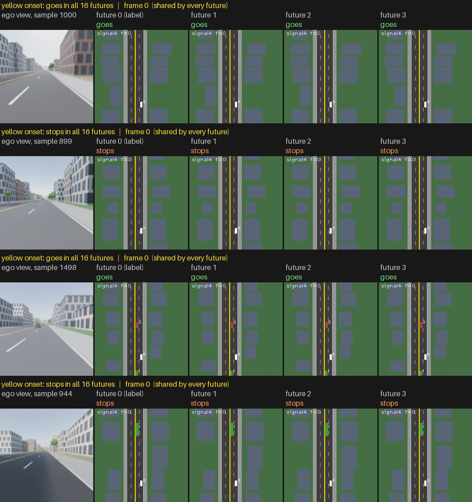
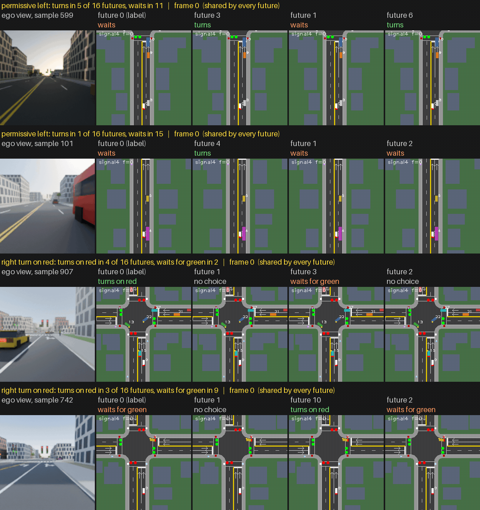
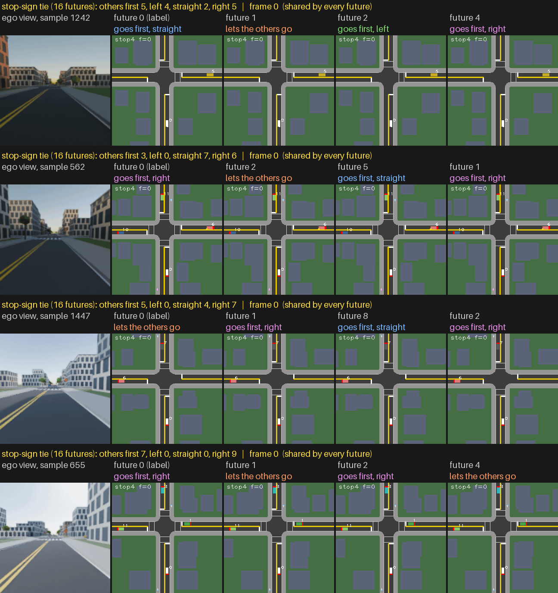
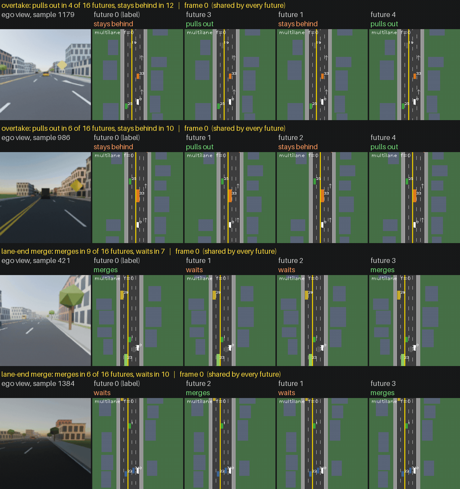
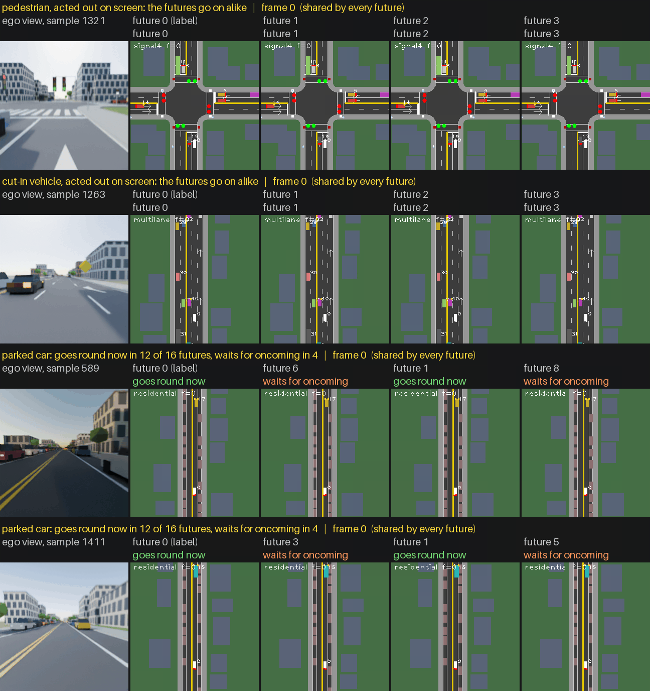
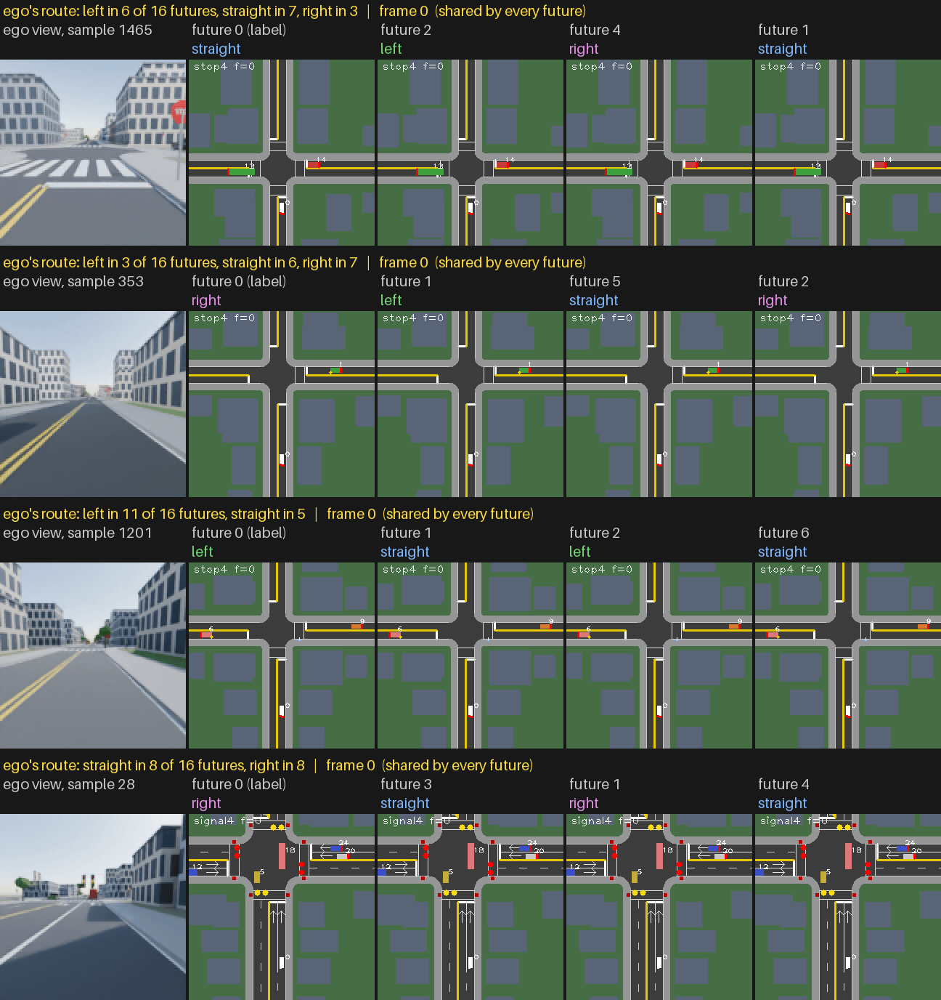

# Forked Futures

Each GIF shows four val samples, one per row. A row shows the ego view of frames 0 to 31, held and dimmed after frame 31, beside the top-down maps of four of the sample's 16 futures. The futures fork at frame 31, and future 0 is the sample's own label. The header counts each outcome over all 16 futures, and the coloured line above each map names that future's outcome.

`python scripts/make_gifs.py /root/projects/drive_v3/val --out assets --showcase --suffix v3r` writes the GIFs.

## Yellow onset

The light turns yellow late, around frame 31, while the ego drives toward it from different distances. The ego goes only if stopping would need more than 3 m/s $^2$ and it reaches its line before red, so every future of a sample responds alike and the rows differ by where the ego was when the light turned.

## Turns at signals

The ego reaches its line around frame 31. Turning left on a green ball, it lets the first oncoming car pass and then takes or lets go the gap the next one leaves; turning right on red, it ends its full stop and takes or lets go the gap in cross traffic.

## Stop-sign ties

The ego and another car end their full stops at about the same time, around frame 31. Each future draws one of the ego's open options, letting the others go or going first to the left, straight ahead or to the right, and the other cars follow it: they wait when it goes first and go when it lets them.

## Lane changes

Held up close behind a slow leader, the ego signals and, once the move could start, pulls out or stays behind. In a lane that ends, it signals once the lane-ends sign is legible and merges ahead of or behind the car alongside.

## Pedestrians, cut-ins and parked cars

In the first two rows a pedestrian crosses or a car cuts in by frame 31, and the futures go on alike. In the last two, the ego closes up behind a parked car as an oncoming car comes past it, and each future either goes round before the next oncoming car or waits for it.

## Route drawn per future

Where the ego's lane allows several moves and the ego has not signalled by frame 31, each future draws the ego's move with equal odds. The first two rows allow three moves and the last two allow two.

